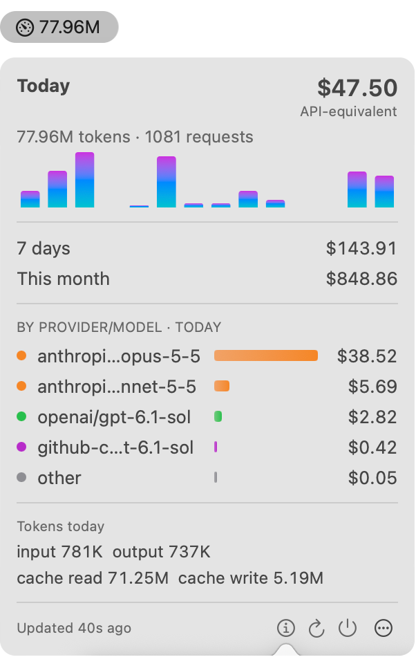
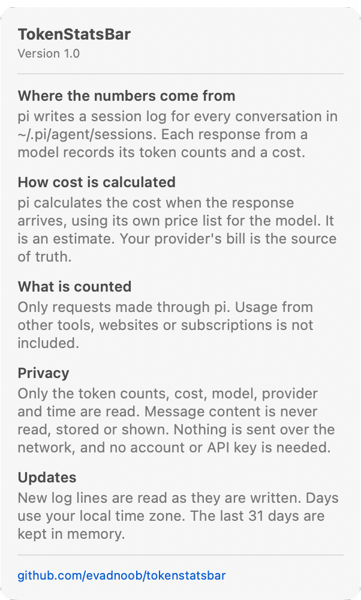

# TokenStatsBar

A macOS menu bar app that shows AI token usage and cost from local pi and Claude Code session logs.

  
  &nbsp;
  

The menu bar shows today's token count. Click it to open a dropdown with:

- today's cost, tokens and requests, with a 14 day chart
- the cost for the last 7 days and for this month
- today's top provider and model pairs by cost
- today's tokens split into input, output, cache read and cache write

Every cost is API-equivalent: what the same usage would cost with an API key. If you use subscriptions, they are
billed differently, so treat the numbers as estimates.

TokenStatsBar reads session logs on your Mac. It needs no account and no API key. Only the numeric usage fields,
model, provider and timestamp are read. Message content is never decoded, stored or shown. Files are read
incrementally and watched with FSEvents, with a 60 second timer as a fallback. Records older than 31 days are not
kept. The only network request downloads the public LiteLLM price list (see Price cache). No usage data is sent.

## Usage details

Click a row in the "by provider and model" section of the dropdown, or open the `⋯` menu and choose Show details...,
to open the usage details window. Clicking a row opens the window drilled into that provider with the model selected
and the range set to Today. The window shows one large sunburst: the inner ring is the providers and the outer ring is
their models, sized by cost or by tokens (choose Cost or Tokens with the dollar and number buttons in the toolbar; models without a price have no slice in
Cost). Hover a slice to see its value and share in the center, click a provider to drill into it, and click a model to
select it. Click the center, the "All" breadcrumb or press Escape to go back up. The side panel lists the slices of the
current level and shows the requests, token counts, cost, split by source and a 14 day sparkline of the selection.
The Chart and Table toggle in the side panel switches the main area to a sortable table with requests, input, output,
cache read, cache write, total tokens, cost and share for each provider and model; click a column header to sort.
Choose the range (Today, 7 days, This month, 31 days) and the source (All, pi, Claude Code) at the top. The window
updates when the dropdown data refreshes.

## Data sources

- **pi**: `~/.pi/agent/sessions/**/*.jsonl`. pi records a cost for each response, and that cost is used.
- **Claude Code** (the `claude` command line tool): `~/.claude/projects/**/*.jsonl` and
  `~/.config/claude/projects/**/*.jsonl`, including subagent files. Anthropic does not document this format. The app
  follows the [observed format](https://github.com/dutchdata/claude-transcript/blob/main/FORMAT.md) of Claude Code
  2.1.233 to 2.1.301. Claude Code writes several lines for one response, so lines with the same message id and
  request id are counted once, using the line with the most tokens. The cost is computed from the price cache.

A model used from both tools appears as one row in the dropdown.

## Price cache

Claude Code does not record a cost, so the app prices each response from the
[LiteLLM price list](https://raw.githubusercontent.com/BerriAI/litellm/main/model_prices_and_context_window.json).
The app keeps the prices of the anthropic, openai, gemini, vertex_ai, xai, mistral and deepseek models in
`~/Library/Caches/com.evadnoob.tokenstatsbar/prices.json`.

- The cache is built on launch when the file is missing.
- To rebuild it, open the `⋯` menu, then Price cache, then Rebuild price cache. If the download fails, the existing
  cache is kept and the error is shown in that menu.
- Show in Finder, in the same menu, reveals the file.
- Costs are computed from the current cache each time, so a rebuild changes the totals without rereading logs.
- A model that is not in the cache is not priced. The dropdown then shows how many requests are excluded.

## Requirements

- macOS 13 or later
- Swift 5.9 or later, from Xcode or the Xcode Command Line Tools (`xcode-select --install`)
- [pi](https://github.com/badlogic/pi-mono), Claude Code, or both

## Installation

1. Clone the repository and build the app bundle:

       git clone git@github.com:evadnoob/tokenstatsbar.git
       cd tokenstatsbar
       ./bundle.sh

   `bundle.sh` builds a release binary and creates `TokenStatsBar.app`, signed with an ad hoc signature.

2. Move the app to `/Applications` and open it:

       mv TokenStatsBar.app /Applications/
       open /Applications/TokenStatsBar.app

   The app has no Dock icon. Look for the gauge icon and today's token count in the menu bar.

3. Optional: to start the app at login, open the dropdown, click the `⋯` button and choose "Launch at login".
   Install the app in `/Applications` first, because the login item points at the app where it is when you turn
   the option on. You can also turn it off in System Settings, General, Login Items.

### Upgrade

    cd tokenstatsbar
    git pull
    ./bundle.sh
    osascript -e 'quit app id "com.evadnoob.tokenstatsbar"'
    rm -rf /Applications/TokenStatsBar.app
    mv TokenStatsBar.app /Applications/
    open /Applications/TokenStatsBar.app

### Uninstall

    osascript -e 'quit app id "com.evadnoob.tokenstatsbar"'
    rm -rf /Applications/TokenStatsBar.app

If you turned on "Launch at login", turn it off in the `⋯` menu before you delete the app, or remove the app
from System Settings, General, Login Items afterwards. The app also writes the price cache (see Price cache). To
remove it:

    rm -rf ~/Library/Caches/com.evadnoob.tokenstatsbar

## Troubleshooting

If the app is running (`pgrep -fl TokenStatsBar`) but the icon is not in the menu bar:

- A menu bar manager such as Ice or Bartender may have put it in its hidden section. Move it to the visible section
  in that app's settings.
- On a Mac with a notch, macOS hides menu bar items that do not fit next to the notch. Quit other menu bar apps to
  make room.
- On recent macOS versions, check System Settings, Menu Bar, and make sure TokenStatsBar is allowed in the menu bar.

If the dropdown says it cannot read session logs, check that `~/.pi/agent/sessions`, `~/.claude/projects` or
`~/.config/claude/projects` exists and contains `.jsonl` files.

## Development

    swift build            # debug build
    tools/run-tests.sh     # run the test harnesses in tools/
    ./bundle.sh            # build TokenStatsBar.app

The code is a library target (`Sources/TokenStatsBarKit`) and a thin executable (`Sources/TokenStatsBarMain`).
Test harnesses are executable targets under `tools/` that use `@testable import`, so they build only in the debug
configuration. `tools/run-tests.sh` runs them with HOME set to a scratch directory in `/tmp`.

## Inspiration

The look and feel is partly inspired by [tokenstat](https://tokenstat.ai), a desktop workspace and usage
tracker for AI coding agents ([announcement](https://gyorgy.sh/blog/tokenstat)). This project is
not affiliated with tokenstat. It is a small personal menu bar app that reads pi and Claude Code session logs only.
